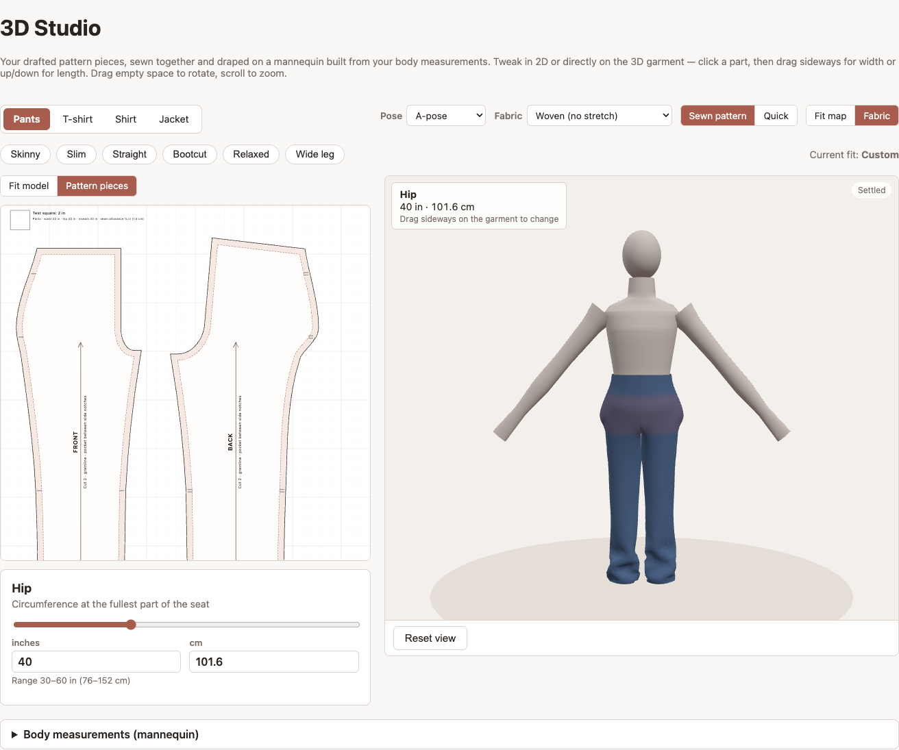
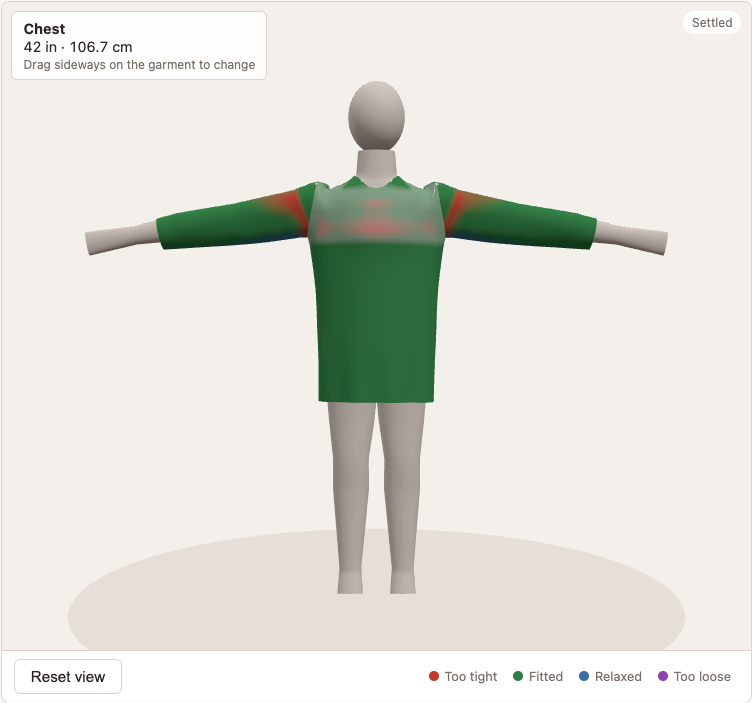
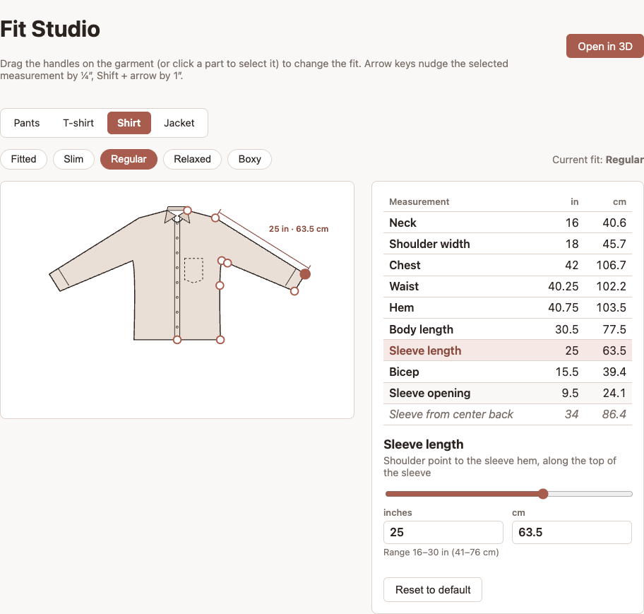
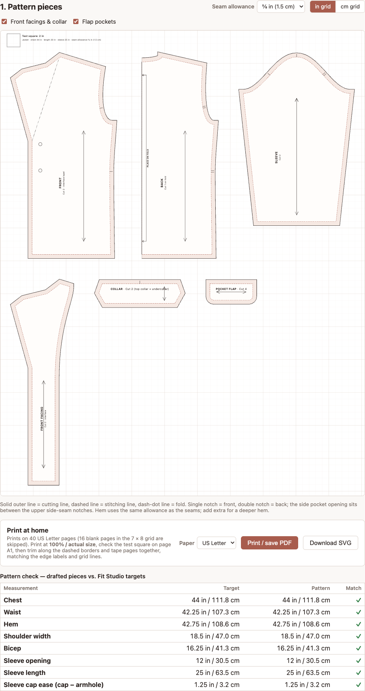

# Stitch Studio

Sewing project tracker: CRUD for projects (with photo upload), a
garment yardage calculator, and a pattern-making workflow for pants,
T-shirts, shirts and jackets:

- **Fit Studio** (`/fit`) — drag handles on a garment model to change the
  fit; measurements shown in inches and cm, with fit presets.
- **Pattern Lab** (`/pattern`) — drafts the pattern pieces from those
  measurements (pants: front/back, waistband, fly, pockets; tops:
  front/back, sleeve with the cap solved to the armhole + ease, plus
  neckband, collar/stand/cuffs or facings/collar/flaps); true-scale SVG
  download, tiled Letter/A4 printing (or save as PDF), a body-vs-garment
  ease check, and saving the pattern to a project.
- **3D Studio** (`/studio`) — CLO3D-style: the 2D editor (fit model or
  pattern pieces) next to a 3D mannequin built from your body
  measurements (including height) in a choice of poses. The drafted
  pattern pieces are triangulated into cloth, arranged around the body,
  sewn together with virtual seams and draped (gravity, body collision
  with friction). Click a part of the 3D garment and drag to change it;
  both views stay in sync. The fit map colors the cloth by how stretched
  it is relative to the flat pattern and how far it hangs off the body.

React + Vite frontend, Express backend, PostgreSQL database, three.js for
3D. Runs either with Docker Compose (one command) or locally with plain
Node/npm.

## Screenshots

**3D Studio** — the drafted pants pattern (left) sewn together and draped
on a mannequin built from body measurements (right):



**Fit map** — a shirt in T-pose; red shows where the cloth is stretched
tight (here the armholes, pulled by the raised arms), green fitted, blue
relaxed, purple loose:



**Fit Studio** — drag handles on the 2D garment; measurements in inches
and cm:



**Pattern Lab** — the drafted jacket: front with lapel, back on the fold,
sleeve with notched cap, facing, collar and pocket flaps:



## Running with Docker

```bash
cp .env.example .env        # Postgres credentials used by docker-compose.yml
docker compose up --build   # http://localhost:8080 (API also on :4000)
```

The schema loads automatically the first time the database volume is
created. If your database volume already existed before a migration was
added, apply it once:

```bash
set -a; . ./.env; set +a
docker compose exec -T db psql -U "$POSTGRES_USER" -d "$POSTGRES_DB" < db/migrations/002_project_pattern.sql
```

`docker compose down` stops everything and keeps your data;
`docker compose down -v` also deletes the database and uploaded photos.

## Running locally (without Docker)

### Prerequisites

- Node.js (v20+) and npm
- PostgreSQL running locally. On this machine it was installed via:
  ```
  brew install postgresql@16
  brew services start postgresql@16
  ```

### First-time setup

```bash
# 1. Create the database and load the schema
createdb -O postgres stitch_studio
psql -U postgres -d stitch_studio -f db/schema.sql
# (databases created before a migration was added: run db/migrations/*.sql too)

# 2. Install dependencies
cd server && npm install
cd ../client && npm install
```

`server/.env` already points at `localhost:5432`, database
`stitch_studio`, user `postgres`, no password — matching the Homebrew
default install. Edit it if your setup differs.

### Start the dev servers

Two terminals:

```bash
# Terminal 1 — backend (http://localhost:4000)
cd server && npm run dev

# Terminal 2 — frontend (http://localhost:5173)
cd client && npm run dev
```

Open http://localhost:5173. The Vite dev server proxies `/api` and
`/uploads` requests to the backend (see `client/vite.config.js`), so
the frontend never needs to know the backend's port directly.

## What's here

- `server/src/db.js` — PostgreSQL connection pool
- `server/src/routes/projects.js` + `controllers/projectsController.js` —
  CRUD REST endpoints, photo upload via multer
- `server/src/data/yardageTable.js` — the yardage lookup table/logic
- `server/src/routes/yardage.js` — exposes garment config + calculation
  as REST endpoints
- `client/src/pages/` — one file per screen (list, form, detail,
  calculator, Fit Studio, Pattern Lab)
- `client/src/fit/` — the pattern-making logic: `garments.js` (one
  registry entry per garment type), `pantsModel.js` / `topModel.js` (fit
  model geometry), `patternDraft.js` + `detailPieces.js` (pants
  drafting), `topDraft.js` (tops drafting), `drag.js` (handle dragging),
  `fitCheck.js` (ease rules), `PatternSheet.jsx` /
  `PrintTiles.jsx` (sheet layout and tiled printing), and
  `MeasurementsContext.jsx` (shared state, saved in localStorage)
- `client/src/three/` — the 3D Studio: `body.js` (parametric mannequin,
  poses and collision surface), `panels.js` (pattern pieces → triangulated
  cloth panels, arrangement and seams), `garmentMesh.js` (the quick
  single-mesh garment), `cloth.js` (position-based cloth simulation),
  `Viewer3D.jsx` (three.js scene, fit map, 3D picking/dragging)
- `client/src/api/client.js` — the only place that calls `fetch`
- `db/schema.sql` — table definition, run once to set up the database
- `db/migrations/` — changes for databases created before they existed

## API reference

| Method | Path                  | Description                          |
|--------|------------------------|---------------------------------------|
| GET    | /api/projects          | list all projects                    |
| GET    | /api/projects/:id      | get one project                      |
| POST   | /api/projects          | create (multipart/form-data, optional `photo`) |
| PUT    | /api/projects/:id      | update (multipart/form-data)         |
| DELETE | /api/projects/:id      | delete (also removes photo file)     |
| PUT    | /api/projects/:id/pattern | save a Pattern Lab draft (JSON, validated) |
| GET    | /api/yardage/garment-types | measurement fields per garment type |
| POST   | /api/yardage/calculate | `{ garmentType, measurements }` → estimate |

## Not in scope yet

No auth, no automated tests, no deployment. The pattern drafts are
simplified blocks (no darts; one-piece sleeves) — sew a muslin before
cutting good fabric.

The 3D simulation uses the main pattern pieces (front, back, sleeves);
collars, cuffs, waistbands, facings and pockets aren't sewn on in 3D, and
fronts are treated as closed at center front. Neck, shoulder and
armhole-seam areas are colored from the measurement check rather than
the simulation. There's no cloth self-collision, and the mannequin is a
simplified parametric body rather than a scanned avatar.
